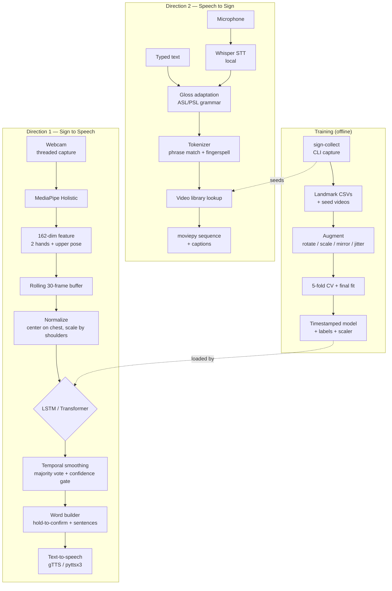

# SignBridge

**A bidirectional ASL + PSL sign language translator.** SignBridge turns
signing into spoken text (webcam → MediaPipe → LSTM → speech) and turns
typed or spoken language back into sign (text/voice → sign-video sequence).
It supports both **American Sign Language (ASL)** and the severely
under-resourced **Pakistan Sign Language (PSL)** in a single tool.

> **Status: research prototype.** SignBridge is not a certified interpreter
> or a medical device. See [Ethics & responsible use](#ethics--responsible-use).

---

## Why this exists

Hearing loss is one of the largest and least-served disability burdens in
Pakistan. Published estimates put roughly **14.5 million Pakistanis living
with hearing loss** (Sheikh et al., *J. Cell. Mol. Med.*, 2024), and Deaf
advocacy organizations estimate the country's Deaf population at **around 10
million** (The Borgen Project, 2024). Access to education and interpreters is
scarce: **fewer than 5% of Deaf children in Pakistan attend school**, with
girls disproportionately excluded (The Borgen Project, 2024).

Despite this, computational tooling for PSL barely exists. ASL has decades of
datasets, recognizers, and commercial products; PSL has a handful of academic
efforts and one major lexicon (FESF, 7,000+ words). **Combining ASL and PSL
in one bidirectional system is the novel contribution of this project** — and
deliberately centers a language the field has overlooked.

PSL also differs structurally from ASL in a way that matters for recognition:
**PSL predominantly uses a two-handed manual alphabet, while ASL uses a
one-handed alphabet** (FESF / psl.org.pk). SignBridge's 162-dimensional
two-hand feature is designed with that difference in mind.

---

## What it does

| Direction | Pipeline |
|-----------|----------|
| **Sign → Speech** | Webcam → MediaPipe Holistic (hands + pose) → 30-frame window → LSTM/Transformer → smoothed sign → word/sentence assembly → text-to-speech |
| **Speech → Sign** | Typed text *or* microphone (local Whisper STT) → gloss adaptation → tokenize → sign-video sequence with synced captions |

Three modes in the UI: **Sign → Speech**, **Speech → Sign**, and a combined
**Conversation** view for two-way exchange.

---

## Architecture



Deeper design rationale lives in [ARCHITECTURE.md](ARCHITECTURE.md).

---

## Setup

Requires **Python 3.11 or 3.12** (TensorFlow 2.16 has no 3.13 wheels), a webcam (for Sign→Speech), and a microphone
(optional, for voice input).

```bash
git clone <your-fork-url> sign_bridge
cd sign_bridge

python -m venv .venv
source .venv/bin/activate          # Windows: .venv\Scripts\activate

pip install -e ".[dev]"            # installs SignBridge + dev tools
```

**Platform notes**

- **Microphone:** SignBridge uses `sounddevice` (PortAudio) rather than
  PyAudio — pip-installable wheels on all platforms, no system build tools.
  On Linux you may still need `sudo apt install libportaudio2`.
- **Whisper** downloads its model weights on first use (the `base` model is
  ~140 MB). Everything runs locally; no audio leaves your machine.
- **TensorFlow** is pinned `<2.17` and **NumPy `<2.0`** for MediaPipe/TF ABI
  compatibility. Keep that constraint if you edit dependencies.
- **MediaPipe** is pinned to `0.10.14`: newer builds removed the
  `mp.solutions.holistic` API SignBridge uses.
- **Video stitching** (Speech→Sign) burns captions with OpenCV, so ImageMagick
  is *not* required.
- **gTTS** needs network access for speech output; switch to the offline
  `pyttsx3` engine in `config.yaml` (or the sidebar) for fully local use.

---

## Quick start

```bash
# 1. Collect training data (also seeds the sign-video library).
sign-collect --label HELLO --mode asl --samples 50
sign-collect --label THANK_YOU --mode asl --samples 50
# … repeat for each sign; for fingerspelling, collect A–Z as labels.

# 2. Train a model for the language.
sign-train --language asl --architecture lstm
#    quick iteration while recording data (skips cross-validation):
sign-train --language asl --skip-cv --epochs 40

# 2b. Or import a public dataset instead of / as well as recording.
#     UAlpha40 (40 Urdu-alphabet PSL signs, ~80 signers, photos + videos):
sign-import --dataset "C:/Users/<you>/Downloads/UAlpha40" --language psl
sign-train --language psl --features hand_shape

# 2c. Transformer models with lip features (v0.3):
sign-train --language asl --architecture conv_transformer --features holistic_lips
#     For the large Google ASL Signs dataset (250 signs), train on a free
#     Kaggle GPU with notebooks/train_asl_signs_kaggle.ipynb, then unzip
#     signbridge_asl_models.zip into models/ (see "Training on Kaggle").

# 3. (Optional) Re-evaluate a saved model on current data.
sign-eval --language asl

# 4. Launch the app.
sign-bridge
```

The UI launches even **before** any model is trained — every tab is fully
styled and explains exactly what to collect/train to enable live features.

---

## The CLI workflow in detail

**`sign-collect`** opens a live preview with a 3-2-1 countdown and records
`--samples` repetitions of a sign. Each repetition writes two artifacts:

- `data/<lang>/<LABEL>/<timestamp>.csv` — landmark features for training, and
- `recordings/<lang>/<LABEL>/<timestamp>.mp4` — the raw clip.

The first clean take (hands visible ≥ 80% of frames) is also copied to
`assets/sign_videos/<lang>/<LABEL>.mp4`, so **collecting training data builds
the Speech→Sign playback library at the same time**.

**`sign-train`** loads all CSVs, normalizes and augments them, runs
**5-fold stratified cross-validation** for an honest accuracy estimate, then
fits a final model on a train/val/test split with early stopping and a
learning-rate schedule. Artifacts are **timestamped and never overwritten**;
a `<lang>_latest.json` pointer tracks the active model. Outputs include the
model, label map, scaler, training curves, confusion matrix, and per-class F1.

**`sign-eval`** re-scores the latest model against current data and writes a
fresh confusion matrix and F1 table.

All hyperparameters live in [`config.yaml`](config.yaml) and are validated by
pydantic at load time — a typo or out-of-range value fails loudly at startup.

### Model architectures

| `--architecture` | What it is |
|---|---|
| `lstm` | Two stacked LSTM layers (the original baseline) |
| `transformer` | Self-attention encoder with learned positions |
| `conv_transformer` | Depthwise 1D convolutions with channel attention, interleaved with Transformer blocks, fed the clip plus its frame-to-frame motion |

| `--features` | Values per frame | Use for |
|---|---|---|
| `holistic` | 162 | hands + upper body, 3D (default) |
| `hand_shape` | 162 | one hand relative to its wrist (photo datasets such as UAlpha40) |
| `holistic_lips` | 188 | hands + upper body + 40 lip points, 2D |

### How live recognition decides (v0.4)

Models trained on one-sign-per-clip data (the Google ASL Signs models)
run in **segment mode**:

- hand movement starts a sign; holding still or lowering the hands ends it;
- the model makes **one guess per finished sign**;
- the guess is shown only when it is confident, otherwise "not sure" plus
  the best guesses.

Pick **My signs** above the camera readout to restrict the recognizer to
the signs you know. That greatly reduces mix-ups while you learn. Thresholds
live under `inference:` in `config.yaml`. The status line shows the current
hand **motion** value, which helps with tuning `motion_start_speed` /
`motion_stop_speed`.

### AI sentences (v0.5)

Sign languages have their own grammar. ASL `MOM DAD NO DRINK` means "Mom
and Dad don't drink." When you finish a sentence, SignBridge can ask an AI
model to write the signed words as natural English.

1. Get an API key. **Google Gemini** has a free tier:
   <https://aistudio.google.com/apikey>.
2. In the app sidebar, under **AI sentences**, paste the key and press
   **Save key**. It is stored in `.streamlit/secrets.toml`, which is never
   committed.
3. Sign, then lower your hands or press **Finish**. The "AI sentence" box
   shows the signs and the English sentence (plus other readings when the
   signs are ambiguous).

Only the sign words are sent to the AI service. Without a key or internet
the app simply joins the words. If you see `error 429`, the free daily quota
is used up — wait, or set another model in `ai.model` (the default is a
Flash-Lite model, which has the largest free quota). To switch provider, set `ai.provider` to
`anthropic` or `openai` in `config.yaml`. To turn the AI off, set it to
`none`.

### Speech → Sign: speak, and the 3D person signs it (v0.13)

On the **Speech → Sign** tab, press the mic, speak, and press stop (or type). Whisper writes
down what you said on this computer, and the 3D person signs it, word by word, with the
current word shown above it and a red spot wherever a finger touches the face. Sentences are
planned against the 250 animated signs, with ASL word order and everyday synonyms (*mother* →
MOM); words with no sign yet are shown crossed out. The first use downloads Whisper's model
(internet needed once).

### "How to sign" animations (v0.6, 3D since v0.9, a 3D person since v0.11)

A box under the camera shows a sign being performed — useful when you are
learning, or when the app says "not sure" and you want to compare. Since v0.11
it is a **3D person** (`src/sign_bridge/ui/static/person.glb`) you can turn with
the mouse (Front / Side / Angle, **Close-up** on the head, double-click to
reset). Its skeleton is posed from the recording every frame: arms by two-bone
IK, every finger joint, the head and the jaw. Since v0.15 the eyebrows and
eyelids follow the recorded face too (raised brows, a frown, narrowed eyes), he
blinks and looks at you, and a hand that is not signing rests at his side.
Where a finger touches the face, a
**red spot** marks the place — thumb on the forehead for DAD, at the temple for
DONKEY, on the chin for MOM — and the fingertip rests on it. A **3D** switch
flips back to the flat drawing. three.js (MIT licence) is bundled, so it works
offline; the model is served by the app itself (Streamlit static serving, which
`sign-bridge` and `.streamlit/config.toml` turn on).

The person was built in Blender from MakeHuman's CC0 body, skeleton and eyes,
with a face texture from an AI-generated portrait (Google Gemini) made by the
project author; hair and clothes were generated by the build scripts in
`tools/avatar/` (see the README there and `src/sign_bridge/ui/avatar/README.txt`).

Arm depth comes from bone lengths rather than MediaPipe's own arm depth, which is
unreliable: an upper arm that looks short from the front must point at the camera,
by the amount Pythagoras gives.

It is off until you build the library:

1. On Kaggle, import `notebooks/make_sign_animations.ipynb`, attach the ASL
   Signs competition data and your project zip, and **Run All** (CPU only,
   a few minutes).
2. Check `animation_preview.png` in the Output panel — its last column is a side
   view: hands in front of the body, face upright.
3. Download `asl.json.gz` into `assets/sign_animations/`.
4. Restart `sign-bridge`.

Controls: choose a sign, set the speed (normal / slow / step frame by frame),
and toggle **Mirror** (on by default) to copy the sign as in a mirror.

The animations are derived from the competition data, so
`assets/sign_animations/` is git-ignored — keep the file local.

### Training on Kaggle (Google ASL Signs)

1. Join the *Google – Isolated Sign Language Recognition* competition on
   Kaggle and accept its rules (this is needed to attach its data).
2. Upload this project's zip as a private Kaggle **Dataset**.
3. Create a notebook with **File → Import Notebook**, choosing
   `notebooks/train_asl_signs_kaggle.ipynb`.
4. **Add Input**: the competition data and your project dataset.
5. **Accelerator → GPU**, then **Run All**.
6. Download `signbridge_asl_models.zip` from the notebook's Output and
   unzip it into `models/`. The app loads the best model automatically.
   `results_table.md` holds the measured comparison.
7. Optional (v0.16): to let several trained models answer together, list their
   file stems in `models/asl_latest.json` under `"ensemble"`, e.g.
   `"ensemble": ["asl_conv_transformer_20261122_103158", "asl_conv_transformer_20261123_222845"]`.
   The app averages their answers. Measured top-1 on unseen signers:

   | models | Kaggle ASL Signs test (4 signers) | ASL Citizen test (11 signers) |
   |---|---|---|
   | run C alone | 72.26% | 92.64% |
   | runs B + C | 72.61% | 93.23% |
   | runs B + C + D | **73.27%** | **93.93%** |

   Run D is run C's recipe with another training seed (`SB_TRAIN_SEED=7`,
   `notebooks/train_asl_run_d.ipynb`). Through the live app on all 2,703 ASL Citizen
   test clips, B + C + D is right 89.9% of the time and wrong 3.8% (the rest "not
   sure"), taking about 24 ms a guess for the three models (measured on a cloud CPU, not on the project laptop).

### Landing page (v0.17)

The app opens on a welcome page; press **Start signing** to go in, and **Home page** in the
sidebar to come back. The same page is published from `docs/` (on GitHub: Settings → Pages →
Source: `main`, folder `/docs`). After editing `src/sign_bridge/ui/landing.html`, rebuild the
public copy with `python -m sign_bridge.ui.landing docs/index.html`.

### Webcam training data: ASL Citizen (v0.8)

Google's ASL Signs data was filmed on **phones held close to the signer**. The
app runs on a **laptop webcam**, further away and with worse light — and the
measured gap between benchmark accuracy and live accuracy (69.1% → 31.0%,
see `results_table.md`) is partly that difference. Microsoft Research's
[ASL Citizen](https://www.microsoft.com/en-us/research/project/asl-citizen/)
is 83,399 **webcam** videos of 2,731 signs by 52 Deaf signers: the same signs,
recorded the way the app actually sees them.

`sign-import-aslcitizen` converts those videos into the landmark clips the
trainer reads. It runs **on this machine, not Kaggle**, for two reasons: the
download is one 42.8 GB zip (larger than a Kaggle session's disk), and the
landmarks must come from the same `mediapipe==0.10.14` Holistic pipeline the
app uses — `solutions.holistic` was removed after 0.10.21, which itself needs
Python ≤ 3.12, while Kaggle now runs 3.13.

```bash
# Request the data from the project page above, then — the zip is never unpacked:
# try 20 videos first to check it reads your copy
sign-import-aslcitizen --source ASL_Citizen.zip --out data/asl_citizen \
    --labels models/asl.labels.json --limit 20

# then the real run: the 250 signs the model already knows, 30 videos each
sign-import-aslcitizen --source ASL_Citizen.zip --out data/asl_citizen \
    --labels models/asl.labels.json --per-sign 30
```

- `--labels` keeps only the signs a model already knows, so the new clips can
  be trained beside the ASL Signs ones. Glosses are matched case- and
  punctuation-insensitively (`ice cream` = `ICE_CREAM` = `ice-cream1`).
- `--per-sign` spreads its pick across signers, so no one person dominates a
  sign.
- `--workers` tracks several videos at once (default: one per core, minus one).
  Tracking costs ~30 ms a frame, so this is what decides whether a run takes
  hours or most of a day. Lower it if you want the machine back while it runs.
- The run is **resumable**: stop it with Ctrl-C and start the same command
  again — anything already in `manifest.csv` is skipped.
- Output: `clips_XXXX.npz` shards of `(N, window, 282)` float16 landmarks,
  `manifest.csv` (gloss, participant, split, source) and `report.json`. Upload
  that folder to Kaggle as a **private** dataset to train on a GPU.

> **Licence.** ASL Citizen is for **non-commercial research only** and may not
> be redistributed. Keep the videos and everything derived from them private:
> publish results, not data.

---

## Accessibility

Accessibility is a design goal, not an afterthought. The "Field Guide" visual
theme was chosen partly because its paper-and-ink palette yields very high
text contrast by default.

- **Captions always available** — sign-video playback shows synced captions;
  the toggle defaults to on and is honored across tabs.
- **High-contrast mode** — switches the entire palette to a maximum-contrast
  black/white scheme and thickens rules and the landmark overlay.
- **Adjustable text size** — a single control scales the whole interface,
  including the large focal sign, from 14 px to 28 px base.
- **Visual-first feedback** — every audio cue has a visual equivalent
  (confidence gauge, locked-sign indicator, status line); the tool never
  relies on sound alone.
- **Keyboard navigation & focus** — controls are reachable by keyboard with
  visible focus outlines.
- **Reduced motion** — animations are disabled under
  `prefers-reduced-motion`.
- **The detected sign is large by default** — readable across a room, which
  is the core job of the Sign→Speech screen.

---

## PSL vocabulary & the novel contribution

SignBridge ships a starter PSL vocabulary of 20 common signs with English
glosses and transliterated Urdu, plus the two-handed manual alphabet. Signs
were chosen from the most common entries in the FESF / Deaf Reach PSL
resources. Each is documented in
[`src/sign_bridge/language/psl_lexicon.py`](src/sign_bridge/language/psl_lexicon.py).

**PSL has regional dialects** (Karachi, Lahore, and others); FESF documents
the "most commonly used" sign per word, and SignBridge follows that choice.
Deployed systems should validate signs with local Deaf communities — see
Ethics below.

---

## Ethics & responsible use

- **This is a prototype, not a certified interpreter or medical device.** Do
  not rely on it for medical, legal, emergency, or other high-stakes
  communication. Use a qualified human interpreter for those.
- **Involve Deaf users in any deployment.** Sign languages are living
  languages owned by their communities. Recognition accuracy, sign choice,
  and dialect coverage must be validated with Deaf signers — especially for
  PSL, where the authors are building on, not speaking for, the community's
  own documentation (FESF/Deaf Reach).
- **PSL community consultation.** The PSL vocabulary derives from FESF's
  publicly published lexicon. This project gratefully acknowledges that work
  and does not claim to define PSL.
- **Bias & training data.** A model is only as representative as its data. A
  recognizer trained by one person, in one room, under one lighting setup,
  with one body type and skin tone, will generalize poorly. Collect diverse
  data (signers, skin tones, lighting, camera angles, handedness) before any
  real use, and report the demographics of your training set.
- **Privacy.** All webcam and microphone processing happens **locally**. No
  video or audio is uploaded. The only optional network call is gTTS for
  speech output, which sends *text* (not audio/video) to Google; switch to
  `pyttsx3` for fully offline operation.

---

## Limitations

- Rule-based grammar adaptation is a coarse approximation; true sign-language
  translation is an open research problem.
- Whole-sign recognition is limited to the trained vocabulary; unknown words
  fall back to fingerspelling.
- Mirror augmentation assumes signs are not handedness-sensitive, which is not
  universally true (notably for PSL's two-handed alphabet) — disable it for
  signs where handedness carries meaning.
- Streamlit repaints the webcam frame over its websocket; expect somewhat lower
  FPS than a dedicated desktop capture app (MediaPipe is the main cost).

---

## Citations

**Deaf accessibility in Pakistan**
- Sheikh, S. A. et al. "Autosomal recessive non-syndromic hearing loss genes
  in Pakistan during the previous three decades." *Journal of Cellular and
  Molecular Medicine*, 2024. (≈14.5 million Pakistanis with hearing loss.)
- The Borgen Project. "Helping the Deaf Community in Pakistan," 2024.
  (≈10 million Deaf; <5% of Deaf children in school.)
- World Health Organization. "Deafness and hearing loss" fact sheet, 2021.

**Pakistan Sign Language**
- Family Educational Services Foundation (FESF). *Pakistan Sign Language
  Dictionary* (7,000+ words). https://psl.org.pk/
- FESF / Deaf Reach. *Signs to Learn* and *1000 Basic Signs*, 2017.
- National Institute of Special Education. *Pakistan Sign Language Book I &
  II.* Government of Pakistan, 1991.
- Khan, N. S. et al. "Speak Pakistan: Challenges in developing Pakistan Sign
  Language using information technology." *South Asian Studies* 30(2), 2014.

**Methods & tools**
- Lugaresi, C. et al. "MediaPipe: A Framework for Building Perception
  Pipelines." 2019.
- Vaswani, A. et al. "Attention Is All You Need." *NeurIPS*, 2017.
- Google. *Isolated Sign Language Recognition* (ASL Signs) Kaggle
  competition and dataset, 2023. https://www.kaggle.com/competitions/asl-signs
  (use the exact citation given on the competition page).
- Desai, A. et al. "ASL Citizen: A Community-Sourced Dataset for Advancing
  Isolated Sign Language Recognition." *NeurIPS Datasets and Benchmarks*,
  2023. Microsoft Research.
  https://www.microsoft.com/en-us/research/project/asl-citizen/
  (Licensed for non-commercial research use; not redistributed here.)
- Wang, Q. et al. "ECA-Net: Efficient Channel Attention for Deep
  Convolutional Neural Networks." *CVPR*, 2020.
- Huang, G. et al. "Deep Networks with Stochastic Depth." *ECCV*, 2016.
- Loshchilov, I. and Hutter, F. "Decoupled Weight Decay Regularization"
  (AdamW). *ICLR*, 2019.
- Szegedy, C. et al. "Rethinking the Inception Architecture for Computer
  Vision" (label smoothing). *CVPR*, 2016.
- Radford, A. et al. "Robust Speech Recognition via Large-Scale Weak
  Supervision" (Whisper). 2022.

---

## Contributing

See [CONTRIBUTING.md](CONTRIBUTING.md) for how to add a new sign, a new
language, or improve recognition.

## AI assistance

Parts of the code, notebooks and documentation were developed with the help
of an AI assistant (Claude, Anthropic), with the course instructor's
permission. Design decisions, experiments and evaluation were carried out
and checked by the authors. All reported results come from runs the authors
performed.

## License

MIT. Note that sign-video assets you record and any third-party datasets you
add carry their own licenses and community norms — respect them.
